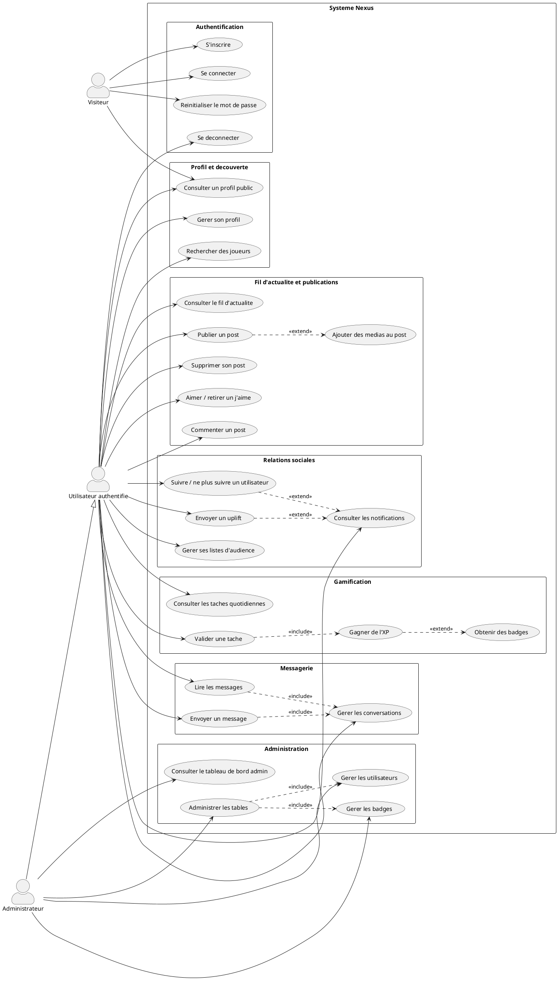
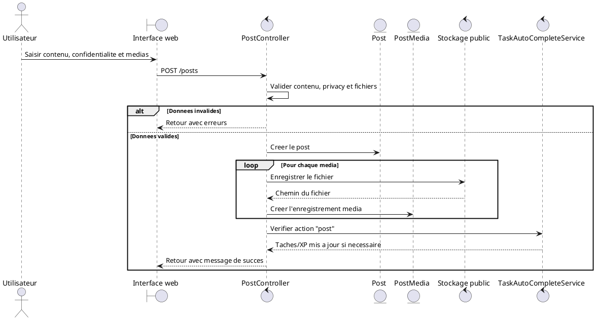
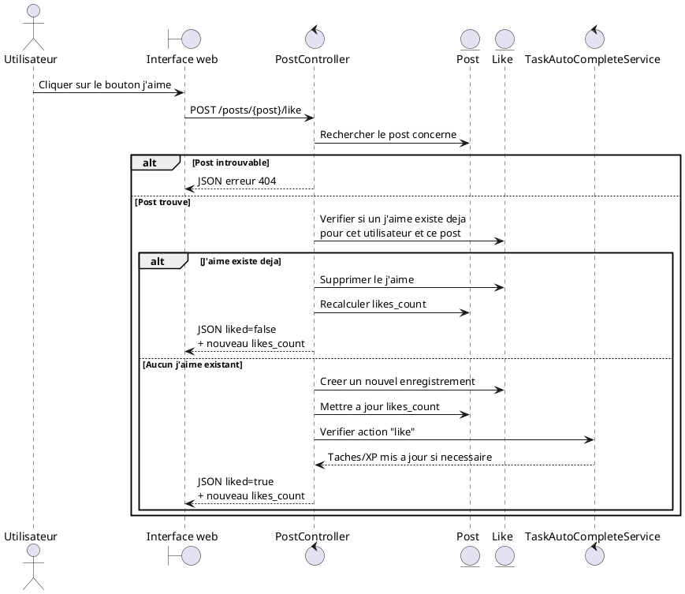
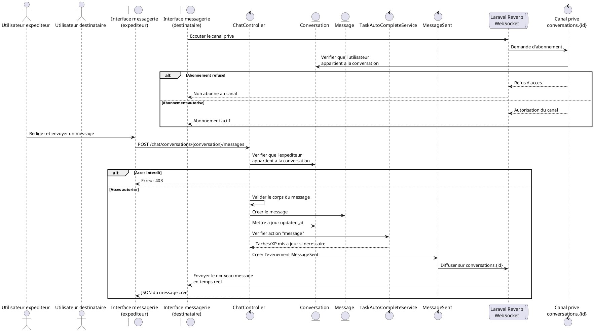
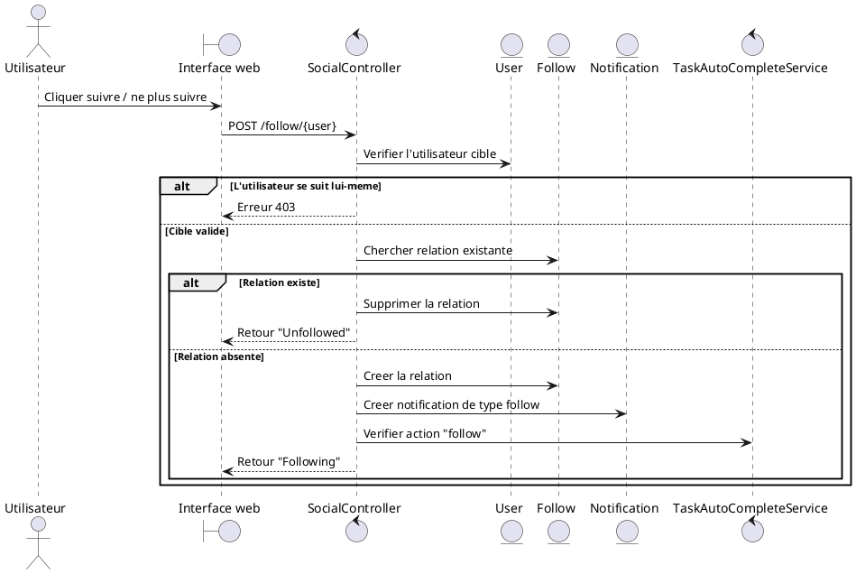
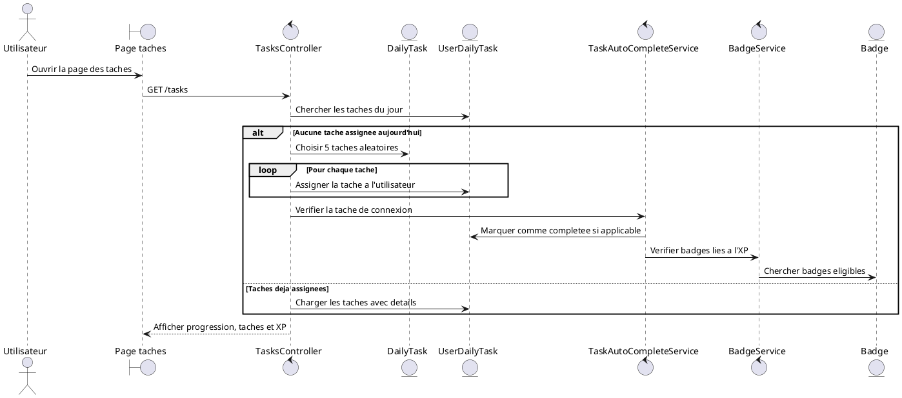
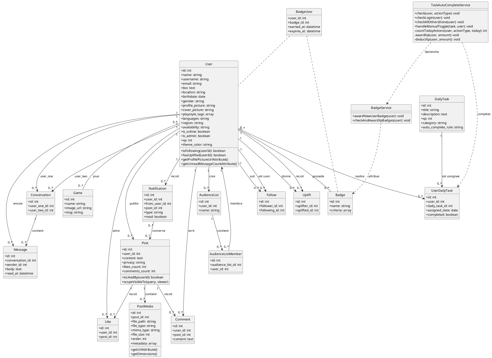

# Diagrammes UML - Nexus

Ce document contient les diagrammes UML en francais pour l'application Nexus.
Les diagrammes sont ecrits en PlantUML afin de pouvoir etre exportes en PNG, SVG ou PDF.

## 1. Diagramme de cas d'utilisation

## 2. Diagrammes de sequence

### 2.1 Creation d'un post avec media

### 2.2 Aimer ou retirer un j'aime sur un post

### 2.3 Envoyer un message dans une conversation

### 2.4 Suivre un utilisateur et creer une notification

### 2.5 Attribution des taches quotidiennes et XP

## 3. Diagramme de classes

